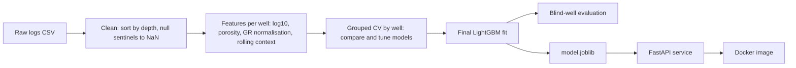
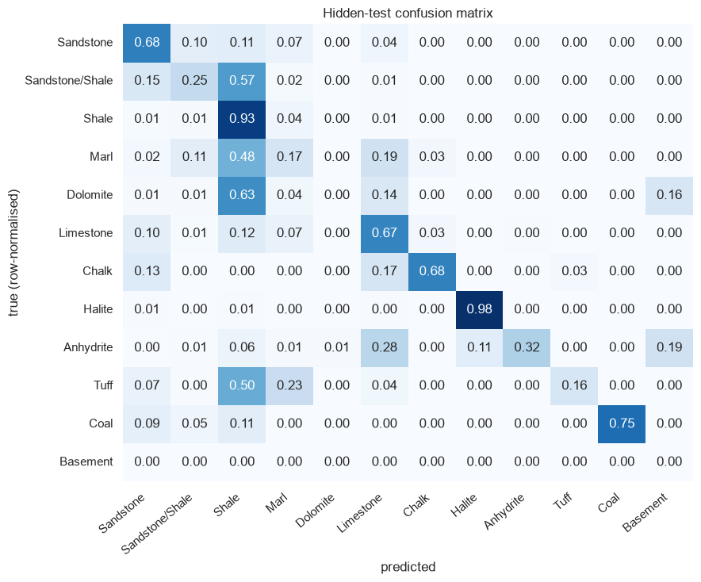
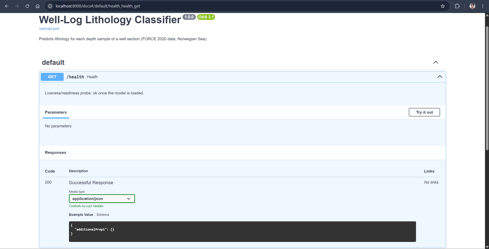
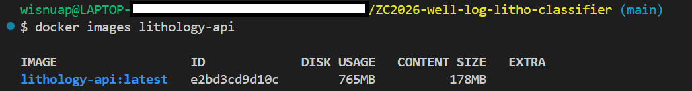
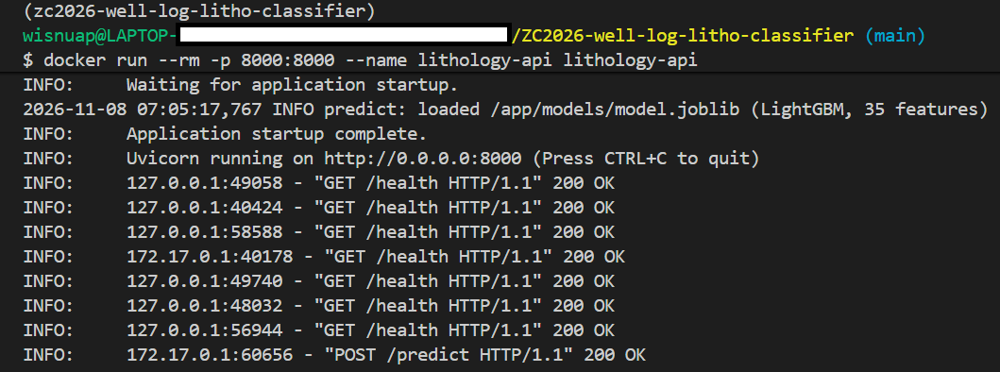

# ZC2026 Well-Log Lithology Classifier

Predict the rock type (lithology) at every depth of a well from its wireline logs, and serve the model as a containerised REST API.

Midterm project for the [DataTalks.Club Machine Learning Zoomcamp](https://github.com/DataTalksClub/machine-learning-zoomcamp).

| | |
|---|---|
| **Task** | 12-class classification of lithology from wireline logs |
| **Data** | FORCE 2020 well-log dataset (98 labelled wells, Norwegian Sea) |
| **Final model** | LightGBM on 35 engineered log features, validated by well |
| **Blind-well score** | penalty score **-0.5782**, accuracy **77.2%** on 10 unseen wells |
| **Serving** | FastAPI + Docker (image 765 MB on disk, 178 MB compressed) |

---

## Table of contents

1. [Problem description](#1-problem-description)
2. [Dataset](#2-dataset)
3. [Approach](#3-approach)
4. [Exploratory data analysis](#4-exploratory-data-analysis)
5. [Modelling and results](#5-modelling-and-results)
6. [Limitations and honest evaluation](#6-limitations-and-honest-evaluation)
7. [Repository structure](#7-repository-structure)
8. [How to run](#8-how-to-run)
9. [Using the API](#9-using-the-api)
10. [Docker](#10-docker)
11. [Cloud deployment](#11-cloud-deployment)
12. [Testing and reproducibility](#12-testing-and-reproducibility)
13. [Acknowledgements and data licence](#13-acknowledgements-and-data-licence)

---

## 1. Problem description

### The geoscience problem

When a well is drilled, tools lowered into the hole record **wireline logs**: continuous measurements of natural radioactivity (gamma ray), bulk density, neutron porosity, sonic travel time, resistivity and more, typically every 15 cm. Different rocks leave different signatures. Shale is radioactive, halite is very low-density, anhydrite is dense, coal is extremely low-density, clean sandstone is low in gamma ray.

Geologists combine these logs with cuttings and cores to interpret a **lithology column**: which rock type occurs at each depth. It is the foundation for reservoir characterisation, well-to-well correlation, volumetrics and drilling decisions. Doing it by hand is slow, subjective, and does not scale to the hundreds of wells in a typical basin study.

### What the model does

Given a continuous section of logs from a well, the model predicts one of **12 lithologies** for every depth sample, with a confidence score.

### How the solution will be used

The model is a **first-pass assistant**, not a replacement for the geologist:

1. A geoscientist uploads the logs of a new well (or an interval) to the API.
2. The service returns a draft lithology column in seconds.
3. The geologist reviews the draft, concentrating on low-confidence intervals and on the lithologies the model is known to confuse (see [section 6](#6-limitations-and-honest-evaluation)).
4. It can also be used for **quality control**: running it over existing interpretations and flagging intervals where the model strongly disagrees with the recorded lithology.

### Why this is a hard machine-learning problem

- **Generalisation to new wells is what matters.** Neighbouring depth samples are almost identical, so a random train/validation split leaks information and reports meaningless scores. This project validates **by well**.
- **Severe class imbalance.** Shale is about 62% of all samples; some lithologies occur in only one to three wells.
- **Not all errors are equal.** Confusing sandstone with halite is far worse than confusing sandstone with a sandstone/shale mix. The project uses the competition's asymmetric **penalty score** alongside macro-F1.
- **Missing and inconsistent curves.** Many wells lack some curves entirely, and null values are encoded as sentinels such as `-999.25`.

---

## 2. Dataset

**FORCE 2020 Well well log and lithofacies dataset for machine learning competition** (Bormann et al., 2020), published on Zenodo (DOI [10.5281/zenodo.4351156](https://doi.org/10.5281/zenodo.4351156)). The CSV files used here come from the competition repository: [bolgebrygg/Force-2020-Machine-Learning-competition](https://github.com/bolgebrygg/Force-2020-Machine-Learning-competition).

| Split | Wells | Rows | Use |
|---|---|---|---|
| `train.csv` | 98 | 1,170,511 | training, cross-validation and tuning |
| `leaderboard_test` | 10 | 136,786 | blind evaluation |
| `hidden_test.csv` | 10 | 122,397 | final blind evaluation |

No well appears in more than one split (asserted in the notebook). Samples are spaced 0.152 m apart.

**The 12 lithology classes:** Sandstone, Sandstone/Shale, Shale, Marl, Dolomite, Limestone, Chalk, Halite, Anhydrite, Tuff, Coal, Basement.

**Curves:** gamma ray (`GR`), bulk density (`RHOB`), neutron porosity (`NPHI`), compressional sonic (`DTC`), three resistivities (`RSHA`, `RMED`, `RDEP`), photoelectric factor (`PEF`), caliper (`CALI`), bit size (`BS`), spontaneous potential (`SP`), density correction (`DRHO`), rate of penetration (`ROP`) and others, plus depth, well coordinates and stratigraphic group.

**Getting the data.** The data is not committed (about 300 MB uncompressed). One command downloads exactly the five files needed from the public repository and unzips them to `data/raw/`:

```bash
uv run python download_data.py
```

It needs `git` on your PATH and is idempotent (it does nothing if the data is already present).

---

## 3. Approach



- **`notebook.ipynb`** holds the exploration, cleaning, feature importance, model comparison and tuning, and writes the chosen configuration to `models/best_config.json`.
- **`train.py`** rebuilds that configuration, trains the final model and saves `models/model.joblib`.
- **`predict.py`** serves the model through FastAPI. The shared logic lives in the `lithology/` package so that training and serving use identical preprocessing.

### Feature engineering (35 features)

All context features are computed **inside one well**, never across wells.

| Group | Features |
|---|---|
| Raw curves (9) | `CALI`, `RHOB`, `GR`, `NPHI`, `PEF`, `DTC`, `SP`, `BS`, `DRHO` |
| Log-transformed (4) | `LOG_RSHA`, `LOG_RMED`, `LOG_RDEP`, `LOG_ROP` (heavy right tails) |
| Petrophysical (5) | `PHID` (density porosity), `ND_SEP` (neutron-density separation, a classic sandstone/gas/shale indicator), `GR_NORM` (gamma ray scaled by the well's own 5th-95th percentile), `GR_GRAD`, `RHOB_GRAD` |
| Bed context (16) | rolling mean and standard deviation of `GR`, `RHOB`, `NPHI`, `DTC` over 15 and 61 samples (about 2.3 m and 9.3 m) |
| Depth (1) | `DEPTH_MD` |

### Validation design

- `StratifiedGroupKFold` (5 folds, seed 42) with the **well name as the group**: a well is never in both training and validation, and rare classes are spread across folds as evenly as the groups allow.
- The notebook asserts that no well leaks across folds.
- Model comparison and tuning use training wells thinned to every 15th sample (about 78k rows), because adjacent samples are nearly duplicates.
- The two blind sets (20 wells) are used **only once**, after model selection.

### Metrics

- **Penalty score** (primary): the competition's metric. For each sample a 12 x 12 matrix gives the penalty for predicting class *j* when the truth is *i*; the score is the **negative mean penalty**. 0 is perfect and more negative is worse. Confusing similar rocks costs little; confusing very different rocks costs up to 4.0.
- **Macro-F1** and **balanced accuracy** treat every class equally, which exposes poor performance on rare lithologies.
- **Accuracy** is reported for reference only because of the class imbalance.

---

## 4. Exploratory data analysis

The full analysis, with plots, is in [`notebook.ipynb`](notebook.ipynb) (sections 2-8). Key findings:

- **Target imbalance.** Shale is about 62% of all samples. Basement occurs in only one well, Halite in three and Anhydrite in six, so well-grouped validation is noisy for these classes.
- **Null sentinels.** Values such as `-999.25` hide inside curves (`SP`, `ROPA`, `RXO`, `DRHO`); they are converted to `NaN` for curve columns only (coordinates can legitimately be below -990).
- **Missing curves.** Seven curves (`SGR`, `DTS`, `RMIC`, `ROPA`, `DCAL`, `MUDWEIGHT`, `RXO`) are missing in more than 70% of rows and are dropped. Other curves such as `ROP`, `SP` and `PEF` are entirely absent in many wells, which is why the model must tolerate `NaN` inputs.
- **Physical separation.** Cross-plots of neutron porosity vs density and gamma ray vs sonic show clear clusters for evaporites, carbonates and shales, with heavy overlap between sandstone, shale and their mixture.
- **Feature-set ablation and importance.** A LightGBM ablation compared raw curves only, plus engineered features, plus depth, and plus stratigraphy and coordinates. Gain and permutation importance were computed on held-out wells.

**Feature Importance and Feature-set Ablation**

| Feature set | Penalty (CV) | Macro-F1 (CV) |
|---|---|---|
| D: raw curves only | -1.1776 | 0.2066 |
| A: + derived and rolling context | -1.0951 | 0.2286 |
| B: A + depth (**chosen**) | -1.0195 | 0.2487 |
| C: B + stratigraphic group + X/Y (reference only, not deployable) | -1.1501 | 0.2282 |

---

## 5. Modelling and results

### Models compared

| Model | Type | Preprocessing |
|---|---|---|
| Majority-class baseline | dummy | none |
| Logistic Regression | **linear** | median imputation with missing-indicators, quantile transform |
| Random Forest | **tree-based** | median imputation with missing-indicators |
| LightGBM | **tree-based (boosting)** | handles `NaN` natively |

Each family was tuned with randomised search (4, 6 and 12 candidates for Logistic Regression, Random Forest and LightGBM) scored with the penalty score on the same well-grouped folds. `class_weight` was part of the search space.

**The Model Comparison Table**

| Model | Default CV penalty | Tuned CV penalty | Macro-F1 (tuned) |
|---|---|---|---|
| Logistic Regression | -0.7841 | -0.7792 | 0.0049 |
| Random Forest | -0.7529 | -0.7448 | 0.0081 |
| LightGBM | -1.0373 | -0.7131 | 0.3241 |


### Final model

LightGBM with the best hyper-parameters found by the search (stored in `models/best_config.json`), trained on 234,137 samples (every 5th sample of the 98 training wells; fit time about 54 s).

**TODO - paste `best_params` from `models/best_config.json`.**

### Blind-well results

| Set | Wells | Penalty | Macro-F1 | Balanced Accuracy | Accuracy |
|---|---|---|---|---|---|
| `hidden_test` | 10 | -0.5782 | 0.4934 | 0.5074 | 0.7717 |
| `leaderboard_test` | 10 | -0.5459 | 0.3662 | 0.3812 | 0.7839 |

For context, the thirteen finalists of the original 2020 competition scored between -0.469 and -0.944 on the hidden wells (different training conditions and effort, so this is only a rough yardstick). This model scores behind twelve of those thirteen finalists: it is a solid, fully reproducible pipeline rather than a leaderboard-topping one.



---

## 6. Limitations and honest evaluation

- **Mixed lithologies are hard.** On a deliberately difficult 600-sample section of well 16/2-7 (six interpreted lithologies), the API agreed with the interpreter on only **32.5%** of samples. Anhydrite was recovered well (118 predicted vs 122 interpreted) but shale was heavily over-predicted (289 vs 25) and the mixed *Sandstone/Shale* class was almost never predicted (1 vs 141). That class is partly a matter of interpreter judgement. Overall hidden-test accuracy (77.2%) is dominated by shale.
- **Rare classes.** Basement, Halite, Tuff and Coal occur in very few wells; their metrics are noisy and should not be over-interpreted.
- **Confidence is not calibrated.** The API's `confidence` is the model's top softmax score. It has not been checked with a reliability diagram, so treat it as a relative indicator, not a probability.
- **Needs a continuous section.** Rolling-window features, gradients and per-well gamma-ray normalisation need neighbouring samples. A single depth point cannot be classified reliably; at least 15 samples are required and 61 or more are recommended.
- **Depth spacing.** The model was trained at 0.152 m sampling. Other spacings shift the rolling windows; the API warns when the spacing differs by more than 25%, and the logs should be resampled first.
- **One basin.** All wells are from the Norwegian Sea. Performance elsewhere is untested.
- **No stratigraphy.** Adding stratigraphic group and coordinates may raise scores in the notebook ablation, but they would be unavailable or risky for a new basin, so the deployed model does not use them.

**Ideas for future work:** probability calibration with out-of-fold predictions; sequence models (1-D CNN or bidirectional LSTM) that read whole depth intervals; weighting samples by the interpreter-confidence flag; an endpoint that resamples logs to the training spacing; drift monitoring on incoming curves.

---

## 7. Repository structure

```
zc2026-well-log-litho-classifier/
├── README.md
├── notebook.ipynb          # cleaning, EDA, feature importance, model selection and tuning
├── train.py                # trains the final model from models/best_config.json
├── predict.py              # FastAPI service
├── download_data.py        # reproducible data download
├── example_request.py      # sends a real well section to the running API
├── pyproject.toml          # dependencies
├── uv.lock                 # exact locked versions
├── .python-version
├── Dockerfile
├── .dockerignore
├── lithology/              # shared package: config, features, metrics, model builder
│   ├── config.py
│   ├── features.py
│   ├── metrics.py
│   └── modeling.py
├── models/
│   ├── best_config.json    # model and hyper-parameters chosen in the notebook (not committed)
│   └── model.joblib        # trained model (not committed)
├── tests/                  # pytest suite (metrics, features, model builder, API)
├── deploy/
│   └── cloud_run.ps1       # Google Cloud Run deployment script
├── docs/images/            # screenshots used in this README
└── data/raw/               # downloaded data (not committed)
```

---

## 8. How to run

### Prerequisites

- [`uv`](https://docs.astral.sh/uv/getting-started/installation/) (manages Python 3.11 and the virtual environment)
- `git`
- Docker (only for the container steps)

The commands below are for **Windows PowerShell**; on Linux or macOS use the activation line shown.

### 1. Get the code and create the environment

```powershell
git clone https://github.com/wapratama/zc2026-well-log-litho-classifier.git
cd zc2026-well-log-litho-classifier

uv sync --locked                  # installs exactly the versions in uv.lock into .venv
.venv\Scripts\Activate.ps1        # activate, if needed (Linux/macOS: source .venv/bin/activate)
```

Activation is optional: every command below also works as `uv run <command>`.

On Windows, enabling UTF-8 mode avoids encoding errors: `$env:PYTHONUTF8 = "1"`.

### 2. Download the data

```powershell
uv run python download_data.py
```

### 3. Explore, select and tune the model

```powershell
uv run jupyter lab
```

Open `notebook.ipynb` from the project root and choose **Run All**. The settings cell at the top controls the cost (`STRIDE_DEV`, `N_ITER_*`). The notebook finishes by writing `models/best_config.json`.

### 4. Train the final model

```powershell
uv run python train.py
```

This rebuilds the selected model, trains it, re-scores the hidden-test wells (the score should match the notebook) and writes `models/model.joblib`. Use `--stride 1` to train on every depth sample.

### 5. Run the tests

```powershell
uv run pytest -q
```

### 6. Serve the model locally

```powershell
uv run uvicorn predict:app --host 0.0.0.0 --port 8000
```

Interactive documentation: <http://localhost:8000/docs>

In a second terminal, send a real well section from the hidden-test set:

```powershell
uv run python example_request.py --well 16/2-7 --start 9000 --rows 600
```

---

## 9. Using the API

| Endpoint | Purpose |
|---|---|
| `GET /health` | liveness probe: `{"status":"ok","model_loaded":true}` |
| `GET /info` | model metadata, accepted curves, input limits |
| `POST /predict` | predict lithology for a well section |

### Request

`DEPTH_MD` is required on each sample; every curve is optional (`null` means not recorded). Accepted curves: `GR`, `RHOB`, `NPHI`, `DTC`, `RDEP`, `RMED`, `RSHA`, `PEF`, `CALI`, `BS`, `SP`, `DRHO`, `ROP`. Unknown field names are rejected (so a typo such as `GRR` cannot silently degrade the model), and null sentinels such as `-999.25` are cleaned.

```json
{
  "well": "my-well-1",
  "include_probabilities": false,
  "samples": [
    {"DEPTH_MD": 2072.12, "GR": 78.4, "RHOB": 2.45, "NPHI": 0.31, "DTC": 92.0, "RDEP": 1.2, "RMED": 1.1, "RSHA": 1.0, "PEF": null},
    {"DEPTH_MD": 2072.27, "GR": 80.1, "RHOB": 2.44, "NPHI": 0.32, "DTC": 93.1, "RDEP": 1.2, "RMED": 1.1, "RSHA": 1.0, "PEF": null}
  ]
}
```

*(Abbreviated: send at least 15 consecutive samples, ideally 61 or more at about 0.15 m spacing, at most 20,000. Samples may arrive unsorted; depths must be unique.)*

### Response

```json
{
  "well": "16/2-7",
  "n_samples": 600,
  "model": "LightGBM (B_logs_depth)",
  "predictions": [
    {"depth_md": 2072.12, "lithology": "Shale", "class_index": 2, "confidence": 0.41, "probabilities": null},
    {"depth_md": 2072.27, "lithology": "Shale", "class_index": 2, "confidence": 0.46, "probabilities": null}
  ],
  "warnings": []
}
```

`warnings` lists non-fatal problems: fewer than 61 samples, a depth spacing far from 0.152 m, large depth gaps, or a key curve that is entirely missing. Invalid input returns HTTP 422 with an explanation.

### Python example

```python
import requests

payload = {"well": "my-well-1", "samples": samples}   # list of dicts as above
response = requests.post("http://localhost:8000/predict", json=payload, timeout=60)
for row in response.json()["predictions"][:5]:
    print(row["depth_md"], row["lithology"], row["confidence"])
```

`example_request.py` builds such a payload from the hidden-test CSV.



*(Screenshot of `http://localhost:8000/docs`.)*

---

## 10. Docker

The image is a multi-stage build: dependencies are installed from `uv.lock` (runtime packages only), the runtime stage is `python:3.11-slim` with the OpenMP library LightGBM needs, the app runs as a non-root user, and a health check calls `/health`. It contains only `predict.py`, `lithology/` and `models/model.joblib`, so building it needs neither the dataset nor the notebook.

**Build** (from the project root; `models/model.joblib` must exist, so run `train.py` first if you cloned without it):

```powershell
docker build -t lithology-api .
```

**Run:**

```powershell
docker run --rm -p 8000:8000 --name lithology-api lithology-api
```

**Check:**

```powershell
curl.exe http://localhost:8000/health
docker ps                         # STATUS should become (healthy) after about 20 s
uv run python example_request.py --well 16/2-7 --start 9000 --rows 600
```

- Image size: 765 MB on disk (178 MB compressed).


- Status: 200 OK (running & healthy)



---

## 11. Cloud deployment

The service deploys to **Google Cloud Run**, which runs the same container tested locally. Requirements: Docker, the [gcloud CLI](https://cloud.google.com/sdk/docs/install), a GCP project with billing enabled, and `gcloud auth login`.

### One command

```powershell
docker build -t lithology-api .
.\deploy\cloud_run.ps1 -ProjectId YOUR_PROJECT_ID
```

[`deploy/cloud_run.ps1`](deploy/cloud_run.ps1) selects the project, enables the Cloud Run and Artifact Registry APIs, creates a Docker repository, pushes the image, deploys it, and prints the service URL after checking `/health`.

### Equivalent manual commands

```powershell
$PROJECT = "YOUR_PROJECT_ID"
$REGION  = "asia-southeast2"      # Jakarta
$IMAGE   = "$REGION-docker.pkg.dev/$PROJECT/lithology/lithology-api:v1"

gcloud config set project $PROJECT
gcloud services enable run.googleapis.com artifactregistry.googleapis.com
gcloud artifacts repositories create lithology --repository-format=docker --location=$REGION
gcloud auth configure-docker "$REGION-docker.pkg.dev"

docker tag lithology-api $IMAGE
docker push $IMAGE

gcloud run deploy lithology-api --image $IMAGE --region $REGION --port 8000 `
    --memory 1Gi --cpu 1 --cpu-boost --min-instances 0 --max-instances 2 --allow-unauthenticated
```

Design choices: scale to zero when idle (the first request after a quiet period is slower because of a cold start), at most 2 instances to cap cost, and a public endpoint, which is acceptable for a demo model built on a public dataset. Delete the service when you no longer need it:

```powershell
gcloud run services delete lithology-api --region asia-southeast2
```

Test the deployed service with `uv run python example_request.py --url https://YOUR-SERVICE-URL --well 16/2-7 --start 9000 --rows 600`.

> **Deployment Status Note:** This repository includes the complete deployment scripts and configuration files required for automated provisioning. Please note that the live service has not been actively deployed to Google Cloud Platform (GCP). All deployment artifacts are not fully tested, verified, and ready to be executed in your target GCP environment.

---

## 12. Testing and reproducibility

- **Dependencies** are pinned in `uv.lock`; `uv sync --locked` fails if the lock file and `pyproject.toml` disagree, so every reviewer gets the same environment.
- **Randomness:** seed 42 everywhere (fold splits, searches, models).
- **Train/serve parity:** `train.py` reproduces the notebook's hidden-test score, and an API test sends a whole well through `/predict` and asserts the predictions equal direct batch prediction.
- **Test suite** (`uv run pytest -q`): the penalty metric against a hand-computed example, features (null sentinels, absent or all-null curves, **no leakage across wells**), the model builder, and the API (valid requests, 422 for malformed input, warnings, train/serve parity).

---

## 13. Acknowledgements and data licence

- Dataset: Bormann et al. (2020), *FORCE 2020 Well well log and lithofacies dataset for machine learning competition*, Zenodo, DOI [10.5281/zenodo.4351156](https://doi.org/10.5281/zenodo.4351156). Dataset licence **CC BY 4.0**; the original well logs are released by the Norwegian government under the **Norwegian Licence for Open Government Data (NOLD 2.0)**.
- The penalty matrix and the lithology-code mapping come from the competition materials.
- Course: [DataTalks.Club Machine Learning Zoomcamp](https://github.com/DataTalksClub/machine-learning-zoomcamp).

## 🛡️ Disclaimer
* **AI-Assisted Content**: Some materials in this repository, including code and documentation, were developed with the assistance of AI tools (Claude and Gemini). All AI-generated outputs have been manually reviewed, refined, and adjusted to ensure technical accuracy and alignment with project goals.
* **Educational Context**: The structure and methodologies applied in this project were inspired by and built upon the curriculum of the **DataTalksClub Machine Learning Zoomcamp**.
* **Copyright & Takedown**: If you identify any content that infringes upon your intellectual property rights or was used without proper authorization, please contact me directly. I am committed to addressing such concerns and will remove the content promptly upon verification.

---
## 👤 Author

**Wisnu Anugrah Pratama**

Built as a Midterm Project for the [DataTalks.Club Machine Learning Zoomcamp](https://github.com/DataTalksClub/machine-learning-zoomcamp).

[](https://www.linkedin.com/in/wisnu-anugrah-pratama/)  
[](https://github.com/wapratama)

---